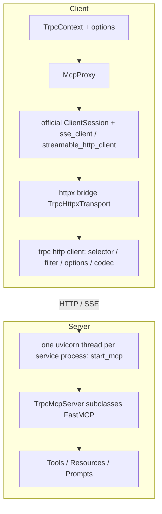

English | [中文](README.zh_CN.md)

# tRPC-MCP-Python

`ttRPC-MCP-Python` is the trpc-python plugin for the **MCP (Model Context Protocol)**. It lets you expose and call MCP capabilities (Tool / Resource / Prompt) the trpc way, and plugs MCP into trpc service governance.

In one line:

```text
trpc-mcp = official MCP SDK (FastMCP / ClientSession) + trpc-python governance (selector / filter / options) + SSE & Streamable-HTTP transports
```

The server declares capabilities with decorators and is hosted by the trpc server. The client calls them through `McpProxy`. The transport bridges to the trpc client, so the full trpc governance stack is reused, while the API stays aligned with the official MCP SDK.

## Highlights

- **Native trpc experience**: the server declares capabilities with `@trpc_mcp.tool / @trpc_mcp.resource / @trpc_mcp.prompt`; the client `McpProxy` resolves and calls a backend from config like any other trpc client.
- **Built on the official MCP SDK**: implemented on top of the official `mcp` SDK (`FastMCP` / `ClientSession` / official transports). New protocol features are mostly inherited, so the maintenance cost stays low.
- **trpc service governance**: the client reuses selector (IP / custom), filter, and options (protocol / namespace / timeout / dyeing).
- **Multiple transports**: SSE and Streamable-HTTP can be switched (stdio is not supported). Multi-process SSE can sync sessions through redis.
- **All process models**: single-process merge (single loop / multi-thread), separate, and peer all work. Each service process runs one MCP app and one uvicorn, and exits gracefully with the framework on SIGTERM.
- **Bidirectional channel**: besides client→server calls, server→client callbacks are supported (`roots/list`, `sampling`, `elicitation`, and others, injected through `session_args`).
- **Structured output**: `outputSchema` and `CallToolResult.structuredContent` are supported, so callers can read results by field.
- **Multi-service isolation**: a capability can be bound to one service, or shared and visible to every service.
- **Version adaptive**: depends on `mcp>=1.11.0,<2` and adapts to version differences (such as `icons` / `meta` / resource `annotations` and `call_tool(meta=)`). Older versions degrade automatically and do not raise.

## Install and quick start

### Requirements

- Python `>=3.10` (3.12 recommended). Use a virtual environment to isolate dependencies.
- The trpc-python SDK (import name `trpc_sdk`, PyPI name `trpc-python`). Windows is not supported.

### Install

```bash
pip install trpc-mcp
```

Dependencies: `trpc-python` (provides `trpc_sdk`), `mcp>=1.11.0,<2`, `uvicorn`, and `redis` (required for multi-process SSE).

### Quick start

#### 1. Server: declare capabilities and start

```python
# trpc_main.py
import trpc_mcp
from trpc_sdk.server import create_server


@trpc_mcp.tool()                       # omit mcp_name -> visible to every service
def add(ctx, a: int, b: int) -> int:
    """Add two integers."""
    return a + b


@trpc_mcp.resource("echo://static", mcp_name="trpc.test.mcp.Greeter1")
def echo_resource(ctx) -> str:         # bound to one service
    return "this is static resource!"


@trpc_mcp.prompt("echo")
def echo_prompt(ctx, prompt: str) -> str:
    return f"this is {prompt}"


def serve(conf_path: str):
    svr = create_server(conf_path)
    trpc_mcp.register_trpc_mcp_server(svr, None)   # attach registered MCP capabilities to the trpc server
    svr.serve()
```

Start:

```bash
python trpc_main.py --conf trpc_python.yaml
```

#### 2. Client: call with McpProxy

```python
import trpc_mcp
from trpc_sdk.abc import TrpcContext
from trpc_sdk.client import Options


async def call():
    proxy = trpc_mcp.McpProxy(
        name="trpc.test.mcp.Greeter1",                 # resolve from config
        options=[Options().set_protocol("http_mcp").set_namespace("Development")],
    )
    try:
        await proxy.initialize(TrpcContext())
        tools = await proxy.list_tools(TrpcContext())
        result = await proxy.execute_tool(TrpcContext(), "add", {"a": 1, "b": 2})
        print(result.structuredContent, result.content)
    finally:
        await proxy.cleanup()
```

> Runnable examples, config notes, and one-shot scripts for each feature (tool / prompt / resource / structured output / icons·meta / roots / custom selector) are in **[`examples/README.md`](examples/README.md)**.

## Design

The client reuses the trpc client governance path and bridges the transport to the official MCP SDK. The server is a trpc adapter that subclasses the official `FastMCP`.



Key points:

- **Client**: `McpProxy` drives the official `ClientSession` and official transports, but every HTTP round trip goes through a custom `httpx` transport into the trpc client. Each request therefore runs trpc node selection, filter, options, and codec.
- **Server**: `TrpcMcpServer` subclasses the official `FastMCP`. `import trpc_mcp` registers the protocol starter with `trpc_sdk.transport.register_protocol_handle("http_mcp", start_mcp)`. The SDK calls it in each service process and starts one uvicorn thread that hosts every `http_mcp` port of that process. Requests pass the trpc server filter chain before entering MCP.
- **Session isolation**: crash isolation for a single Streamable-HTTP session is provided by the official SDK (`mcp>=1.11.0`). trpc-mcp reuses it directly.

## Usage

### Declaring server capabilities

- `@trpc_mcp.tool(name=, title=, description=, structured_output=, annotations=, icons=, meta=, mcp_name=)`
- `@trpc_mcp.resource(uri, name=, title=, description=, mime_type=, icons=, annotations=, meta=, mcp_name=)`
- `@trpc_mcp.prompt(name=, title=, description=, icons=, mcp_name=)`

`mcp_name` selects which service a capability is bound to. Leave it unset for a shared capability (visible to every service). The first function argument is always `ctx` (`TrpcContext`). Use `trpc_mcp.get_http_req(ctx)`, `get_server_addr(ctx)`, `get_session_func(ctx)`, and similar helpers to read the context.

### Client McpProxy

Common methods: `list_tools` / `execute_tool` / `list_resources` / `list_resource_templates` / `read_resource` / `list_prompts` / `get_prompts`.

- host / base_url / transport / target can be resolved from config, or set explicitly in the constructor or `options` (priority: constructor arguments > options > config).
- `options` is a list of `trpc_sdk.client.Options`, applied in order, with later entries overriding earlier ones. `McpProxy` appends `set_protocol("http_mcp")` at the end, and adds a default timeout when no options are passed.
- Custom HTTP headers: `set_http_header_to_context(ctx, {...})` injects them into every HTTP request on that connection.
- Official `ClientSession` callbacks (server→client): `initialize(ctx, session_args={"list_roots_callback": ..., "sampling_callback": ..., "elicitation_callback": ...})`.

### Configuration

MCP settings live under `plugins.mcp`. For example, transport and base_url:

```yaml
plugins:
  mcp:
    server:
      transport: sse            # sse / streamable-http
      base_url: /test
      settings:
        message_path: /messages/
    client:
      transport: sse            # default transport when McpProxy does not set one
      base_url: /test
```

Multi-process SSE uses redis to sync sessions (otherwise a request routed to a different process invalidates the session):

```yaml
plugins:
  mcp:
    server:
      redis:
        host: 127.0.0.1
        port: 6379
        db: 0
```

## Process and thread model

The process model comes from `global.processmodel` in the framework YAML. In every model, **each service process has exactly one MCP app and one uvicorn**: uvicorn runs on its own daemon thread and binds every `http_mcp` port owned by that process with `SO_REUSEPORT`.

| Model | YAML | Where MCP / uvicorn runs |
|---|---|---|
| merge, single loop (default) | `processmodel` omitted | 1 in the main process |
| merge, multi-thread | `mode: single_process`, `io_num` / `handle_num` > 1 | 1 in the main process (started by serving thread 0; other threads do not start another) |
| separate | `mode: multi_process`, `io_handle_type: separate`, `handle_num: N` | 1 per rpc task process; the I/O process does not listen on `http_mcp` ports |
| peer | `mode: multi_process`, `io_handle_type: peer` (or `merge`), `handle_num: N` | 1 per peer worker process |

```yaml
global:
  processmodel:
    mode: multi_process
    io_handle_type: separate
    handle_num: 2          # 0 means the CPU count
```

**Automatic process-count adjustment**: under separate / peer, when the process count is greater than 1, `register_trpc_mcp_server` sets the process count to 1 before fork and logs a warning if `plugins.mcp.server.redis` is missing or `settings.stateless_http` is `false`. An MCP session is in-process state, so multiple processes require both “redis for SSE session sync” and “stateless HTTP”. Merge mode is unaffected.

**Graceful shutdown**: after SIGTERM, the framework `exit_callbacks` stop uvicorn from accepting new connections and start graceful shutdown (timeout is the framework drain time). `post_drain_callbacks` then wait for the uvicorn thread to finish (drain time + 2 seconds; a timeout logs a warning).

**Limits**:

- The uvicorn event loop sits outside the SDK thread model: MCP requests run server filters and capability functions on the uvicorn thread. They do not occupy framework handle threads and are not covered by its queueing or overload protection.
- When an MCP capability function calls downstream with a trpc client, that client connection belongs to the uvicorn thread's loop. Do not reuse an HTTP client session created on another loop.

## Notes

- **Protocol**: both server and client use `http_mcp` for `protocol`. A custom selector must also return `node.protocol` as `http_mcp`, or the codec is downgraded.
- **base_url**: client and server must match, or path joining returns 404.
- **SSE**: a single process is enough. Multiple processes (separate / peer) must configure redis and `stateless_http: true`, otherwise the process count is reduced to 1 (see “Process and thread model” above).
- **Streamable-HTTP**:
  - Stateful (`stateless_http: false`): single process only. redis is not supported yet.
  - Stateless (`stateless_http: true`): multiple processes are supported, but `list_roots` is not.
- **`list_roots`**: supported in every SSE setup. Streamable-HTTP requires `stateless_http: false` and a single process.
- **stdio is not supported** (configuring it raises immediately).

## Layout

- `trpc_mcp/tools.py` / `resources.py` / `prompts.py`: capability decorators and registries.
- `trpc_mcp/_trpc_mcp_server.py`: `TrpcMcpServer` (subclasses `FastMCP`), including service isolation, tool filter, and `call_tool`.
- `trpc_mcp/_trpc_server_transport.py`: the `http_mcp` protocol starter `start_mcp`. Per process it builds the MCP app, starts the uvicorn thread, and registers graceful-shutdown callbacks.
- `trpc_mcp/service_desc.py`: `register_trpc_mcp_server`, which adjusts the process count for the process model.
- `trpc_mcp/_sse_transport.py`: SSE transport (including multi-process redis sync).
- `trpc_mcp/mcp_client.py`: client `McpProxy`.
- `trpc_mcp/_httpx_transport.py`: bridges official MCP SDK httpx requests to the trpc client (including streamable-transport version adaptation).
- `trpc_mcp/_codec.py`: client and server codec for the `http_mcp` protocol.
- `trpc_mcp/_compat.py`: version-compatibility shim for optional `mcp.types` symbols (such as `Icon`).
- `trpc_mcp/mcp_api.py` / `utils.py`: context readers and helpers for injecting HTTP headers and parameters.
- `examples/`: runnable examples, see [`examples/README.md`](examples/README.md).
- `docs/troubleshooting.md`: troubleshooting notes; `docs/compatibility_old_vs_new.md`: compatibility comparison of the old and new implementations.

## FAQ

### Can the client `protocol` be `http`?

Use `http_mcp` everywhere. If the client or a custom selector falls back to plain `http`, the MCP codec is downgraded and an SSE POST `202 ACCEPTED` is treated as an error. `McpProxy` forces `http_mcp` internally, but `node.protocol` returned by a selector still has to be `http_mcp`.

### Why does `list_roots` fail on streamable-http?

`list_roots` is a server-initiated request back to the client and needs a stateful session. Under Streamable-HTTP it requires `stateless_http: false` and a single process. Stateless mode or multiple processes cannot reach the same session. SSE does not have this limit.

### Why does multi-process SSE require redis?

Sessions in `sse-starlette` are in-process state. With multiple processes, the process that receives the POST may not be the process holding the SSE connection, so redis is required to sync messages and sessions across processes.

### Will new features raise if an older mcp is installed?

No. `icons` / `meta` / resource `annotations`, `call_tool(meta=)`, and similar APIs exist only in newer versions. trpc-mcp filters arguments against the installed SDK signature. Older versions ignore them and log a warning instead of raising `TypeError`. See `docs/troubleshooting.md`.
