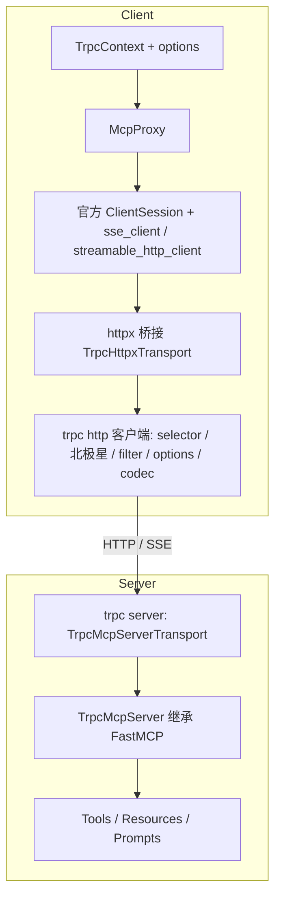

# trpc-mcp

`trpc-mcp` 是 trpc-python 框架对接 **MCP（Model Context Protocol）** 协议的插件。它让你用 trpc 的方式提供和调用 MCP 能力（Tool / Resource / Prompt），并把 MCP 接入 trpc 的服务治理体系。

一句话概括：

```text
trpc-mcp = 官方 MCP SDK（FastMCP / ClientSession）+ trpc-python 服务治理（selector / 北极星 / filter / options）+ SSE & Streamable-HTTP 传输
```

服务端用装饰器声明能力、由 trpc server 托管；客户端用 `McpProxy` 调用，传输层桥接到 trpc 客户端，从而复用 trpc 全套治理能力，同时接口形态与官方 MCP SDK 保持一致。

## 核心特点

- **trpc 原生体验**：服务端 `@trpc_mcp.tool / @trpc_mcp.resource / @trpc_mcp.prompt` 声明能力；客户端 `McpProxy` 像普通 trpc 后端一样按配置寻址、调用。
- **复用官方 MCP SDK**：构建在官方 `mcp` SDK 之上（`FastMCP` / `ClientSession` / 官方传输），协议新特性大多"继承即用"，维护成本低。
- **对接 trpc 服务治理**：客户端复用 selector（IP / 北极星 / 自定义）、filter、options（协议 / 命名空间 / 超时 / 染色）等治理链路。
- **多传输支持**：SSE 与 Streamable-HTTP 两种传输可切换（不支持 stdio）；多 worker SSE 可用 redis 做会话同步。
- **双向通道**：除 client→server 调用外，支持 server→client 回调（`roots/list`、`sampling`、`elicitation` 等，通过 `session_args` 注入）。
- **结构化输出**：支持 `outputSchema` 与 `CallToolResult.structuredContent`，调用方可按字段可靠读取结果。
- **多 service 隔离**：能力可绑定到指定 service，也可作为公共能力被所有 service 访问。
- **版本自适应**：依赖 `mcp>=1.11.0,<2`，对各版本差异（如 `icons`/`meta`/resource `annotations`、`call_tool(meta=)`）做了自适应，低版本自动降级不报错。

## 安装与快速开始

### 环境要求

- Python `>=3.10`（推荐 3.12），建议用虚拟环境隔离依赖。

### 安装

```bash
pip install trpc-mcp -i  --extra-index-url
```

升级（强制更新到指定版本，版本号按需替换）：

```bash
pip install --upgrade --force-reinstall trpc_mcp==0.3.0a1 -i  --extra-index-url
```

依赖：`mcp>=1.11.0,<2`、`trpc>=0.9.6`、`redis`（多 worker SSE 场景需要）。

### 快速开始

#### 1. 服务端：声明能力并启动

```python
# trpc_main.py
import trpc
import trpc_mcp


@trpc_mcp.tool()                       # 不指定 mcp_name -> 所有 service 可见
def add(ctx, a: int, b: int) -> int:
    """两个整数相加"""
    return a + b


@trpc_mcp.resource("echo://static", mcp_name="trpc.test.mcp.Greeter1")
def echo_resource(ctx) -> str:         # 绑定到指定 service
    return "this is static resource!"


@trpc_mcp.prompt("echo")
def echo_prompt(ctx, prompt: str) -> str:
    return f"this is {prompt}"


def serve(conf_path: str):
    svr = trpc.new(conf_path)
    trpc_mcp.register_trpc_mcp_server(svr, None)   # 把已注册的 MCP 能力挂到 trpc server
    svr.serve()
```

启动：

```bash
python trpc_main.py --conf trpc_python.yaml
```

#### 2. 客户端：用 McpProxy 调用

```python
import trpc_mcp
from trpc.client.options import with_protocol, with_namespace
from trpc.context import TrpcContext


async def call():
    proxy = trpc_mcp.McpProxy(
        name="trpc.test.mcp.Greeter1",                 # 按配置自动寻址
        options=[with_protocol("http_mcp"), with_namespace("Development")],
    )
    try:
        await proxy.initialize(TrpcContext())
        tools = await proxy.list_tools(TrpcContext())
        result = await proxy.execute_tool(TrpcContext(), "add", {"a": 1, "b": 2})
        print(result.structuredContent, result.content)
    finally:
        await proxy.cleanup()
```

> 各功能（tool / prompt / resource / 结构化输出 / icons·meta / roots / 自定义 selector / 北极星）的完整可运行示例、配置说明与一键运行脚本见 **[`examples/README.md`](examples/README.md)**。

## 整体设计

客户端复用 trpc 客户端治理链路，传输层桥接到官方 MCP SDK；服务端是继承官方 `FastMCP` 的 trpc 适配层。



要点：

- **客户端**：`McpProxy` 驱动官方 `ClientSession` 与官方传输，但所有 HTTP 往返通过 `httpx` 自定义传输落到 trpc 客户端，从而每次请求都走 trpc 的节点选择、filter、options 与编解码。
- **服务端**：`TrpcMcpServer` 继承官方 `FastMCP`，由 `TrpcMcpServerTransport` 接入 trpc server，能力通过装饰器注册。
- **会话隔离**：Streamable-HTTP 的单会话崩溃隔离由官方 SDK（`mcp>=1.11.0`）保证，trpc-mcp 直接复用。

## 使用方式

### 服务端能力声明

- `@trpc_mcp.tool(name=, title=, description=, structured_output=, annotations=, icons=, meta=, mcp_name=)`
- `@trpc_mcp.resource(uri, name=, title=, description=, mime_type=, icons=, annotations=, meta=, mcp_name=)`
- `@trpc_mcp.prompt(name=, title=, description=, icons=, mcp_name=)`

`mcp_name` 决定能力绑定到哪个 service；不填则为公共能力（所有 service 可见）。函数第一个参数固定是 `ctx`（`TrpcContext`），可用 `trpc_mcp.get_http_req(ctx)`、`get_server_addr(ctx)`、`get_session_func(ctx)` 等读取上下文。

### 客户端 McpProxy

常用方法：`list_tools` / `execute_tool` / `list_resources` / `list_resource_templates` / `read_resource` / `list_prompts` / `get_prompts`。

- host / base_url / transport / target 可从配置自动解析，也可在构造或 `options` 显式指定（优先级：构造参数 > options > 配置）。
- 自定义 HTTP 头：`set_http_header_to_context(ctx, {...})`，会注入到该连接的每个 HTTP 请求。
- 注入官方 `ClientSession` 回调（server→client）：`initialize(ctx, session_args={"list_roots_callback": ..., "sampling_callback": ..., "elicitation_callback": ...})`。

### 配置

MCP 相关配置在 `plugins.mcp`，例如选择传输和 base_url：

```yaml
plugins:
  mcp:
    server:
      transport: sse            # sse / streamable-http
      base_url: /test
      settings:
        message_path: /messages/
    client:
      transport: sse            # McpProxy 未显式传参时的默认传输
      base_url: /test
```

多节点 SSE 用 redis 做会话同步（否则请求路由到不同 worker 会导致 session 失效）：

```yaml
plugins:
  mcp:
    server:
      redis:
        host: 127.0.0.1
        port: 6379
        db: 0
```

## 注意事项

- **协议**：服务端与客户端的 `protocol` 都用 `http_mcp`；自定义 selector 返回的 `node.protocol` 也要是 `http_mcp`，否则 codec 会被降级。
- **base_url**：客户端与服务端要一致，否则路径拼接 404。
- **SSE 模式**：`worker_num: 1`；若要多 worker，必须配置 redis（框架多进程，对有状态服务不友好）。
- **Streamable-HTTP 模式**：
  - 有状态（`stateless_http: false`）：要求 `worker_num: 1`，暂不支持 redis。
  - 无状态（`stateless_http: true`）：支持多进程，但不支持 `list_roots` 调用。
- **`list_roots` 支持条件**：SSE 模式都支持；Streamable-HTTP 必须 `stateless_http: false` 且 `worker_num: 1`。
- **不支持 stdio 传输**（配了会直接报错）。

## 目录参考

- `trpc_mcp/tools.py` / `resources.py` / `prompts.py`：能力注册装饰器与注册表。
- `trpc_mcp/_trpc_mcp_server.py`：`TrpcMcpServer`（继承 `FastMCP`），含 service 隔离、tool filter、call_tool 等。
- `trpc_mcp/_trpc_server_transport.py`：接入 trpc server 的服务端传输，注册能力到 FastMCP。
- `trpc_mcp/_sse_transport.py`：SSE 传输（含多 worker redis 同步）。
- `trpc_mcp/mcp_client.py`：客户端 `McpProxy`。
- `trpc_mcp/_httpx_transport.py`：把官方 MCP SDK 的 httpx 请求桥接到 trpc 客户端（含 streamable 传输版本自适应）。
- `trpc_mcp/_codec.py`：`http_mcp` 协议的客户端/服务端编解码。
- `trpc_mcp/_compat.py`：可选 `mcp.types` 符号（如 `Icon`）的版本兼容垫片。
- `trpc_mcp/mcp_api.py` / `utils.py`：上下文读取与 HTTP 头/参数注入等工具。
- `examples/`：完整可运行示例，见 [`examples/README.md`](examples/README.md)。
- `docs/troubleshooting.md`：排障备忘；`docs/compatibility_old_vs_new.md`：新旧实现兼容性对比。

## 常见问题

### 客户端 `protocol` 配成 `http` 可以吗？

建议统一用 `http_mcp`。若客户端或自定义 selector 退回成普通 `http`，会把 MCP 专用 codec 降级，导致 SSE POST 的 `202 ACCEPTED` 被当成错误。`McpProxy` 内部会强制 `http_mcp`，但 selector 返回的 `node.protocol` 仍需是 `http_mcp`。

### 为什么 streamable-http 测 `list_roots` 失败？

`list_roots` 是服务端反向请求客户端，依赖有状态 session。Streamable-HTTP 下必须 `stateless_http: false` 且 `worker_num: 1`；stateless 或多 worker 会拿不到同一个 session。SSE 模式不受此限制。

### sse 协议下，多 worker 为什么必须配 redis？

`sse-starlette` 的 session 是进程内状态。多 worker 时 POST 命中的 worker 与持有 SSE 长连接的 worker 可能不是同一个，需要 redis 做跨 worker 的消息/会话同步。

### 装了较低版本的 mcp，新特性会报错吗？

不会。`icons`/`meta`/resource `annotations`、`call_tool(meta=)` 等是较高版本才有的；trpc-mcp 按已安装 SDK 的签名做自适应过滤，低版本会自动忽略并打印告警，不会抛 `TypeError`。详见 `docs/troubleshooting.md`。
